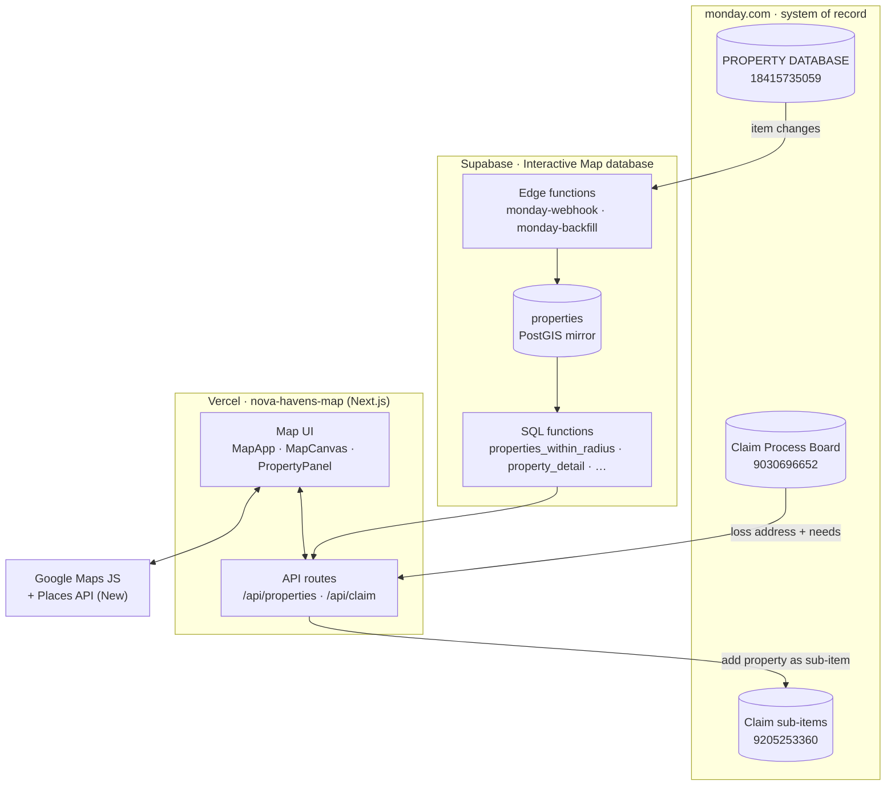
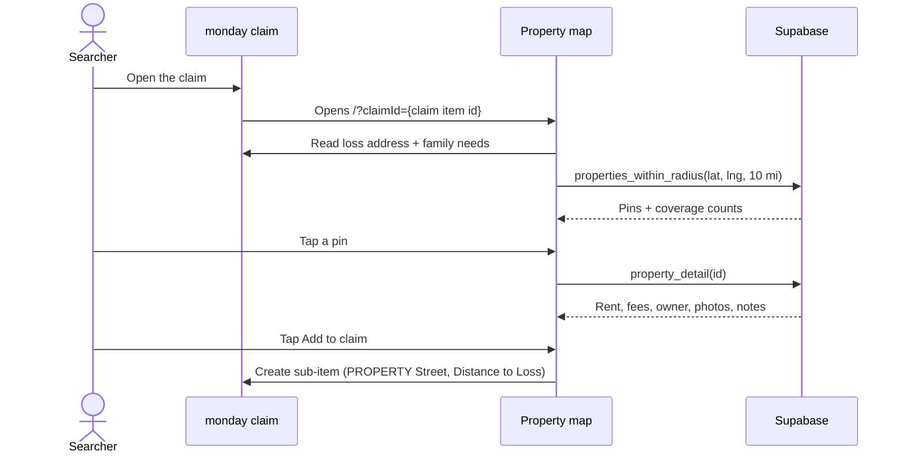

<div align="center">

# 🗺️ Nova Havens · Property Map

**Find temporary housing near a family's damaged home — in seconds, straight from the Monday property database.**

[](https://nova-havens-map.vercel.app)
[](https://nextjs.org)
[](https://react.dev)
[](https://supabase.com/dashboard/project/nmandvqfuwvqxeabptjd)
[](https://novahavens-company.monday.com/boards/18415735059)
[-4285F4?logo=googlemaps&logoColor=white)](https://developers.google.com/maps/documentation/javascript)

[**Open the map**](https://nova-havens-map.vercel.app) · [Using it](#-using-the-map) · [How it works](#-how-it-works) · [Run it locally](#-run-it-locally) · [Deploy](#-deploying) · [Troubleshooting](#-troubleshooting)

</div>

---

> [!IMPORTANT]
> **Source is in this repo as of 12 Oct 2026; deploys from `main`.** The Next.js app at the repo root is byte-for-byte the production deployment `dpl_6beu23Uhss23wPB2hEJVWqAkG74r` (29 Sep 2026). The earlier AI Studio prototype now lives in `legacy/` — see [Legacy prototype](#-legacy-prototype).

---

## ✨ What it does

Nova Havens places families displaced by insurance claims into temporary housing. When a claim comes in, a searcher needs to know **which of our ~15,700 properties are close to the damaged home, available, and a fit for the family** — and then send the best options back on the claim.

The Property Map does exactly that:

| | |
|---|---|
| 📍 **Loss-centred search** | Opens on the claim's *Damaged Residence Address* and shows every mapped property within 5–30 miles. |
| 🧮 **Fit at a glance** | Rent, beds/baths, pets, photos and a single **move-in total** (first month + every deposit and one-off fee) per property. |
| 👪 **Knows the family** | Reads the claim's needs — adults, children, bedrooms, bathrooms, pets, FRV and move-in date. |
| ➕ **One-tap shortlist** | **Add to claim** puts a property on the claim as a Monday sub-item, with **Distance to Loss (mi)** filled in. |
| 🗂️ **Honest coverage** | Says how many properties can't be shown because they have no coordinates — nothing is silently hidden. |
| 🌗 **Light & dark** | Follows the system theme, with a toggle. |

---

## 🧭 Using the map

**From a claim (normal way).** Open the claim in Monday and open the map from it. The map receives the claim's item ID (`?claimId=…`), so the loss address and the family's needs are filled in for you.

**On its own.** Go to **[nova-havens-map.vercel.app](https://nova-havens-map.vercel.app)** and type the loss address in the search box. Everything works except **Add to claim**, because there's no claim to attach to.

Then:

1. **Pick a radius** — 5, 10 (default), 15, 20 or 30 mi.
2. **Narrow down** with the chips: *Pets allowed*, *Has photos*, *Rent listed*.
3. **Scan the list** on the left (sorted by distance) or the pins on the map. Numbered circles are clusters — zoom in to split them.
4. **Tap a property** to open its panel:
   - **Cost to place** — monthly rent, every deposit and fee, and the **move-in total** (recurring pet rent is shown but excluded).
   - **Property** — beds, baths, pets, sq ft, type, furnished, fenced yard, next availability.
   - **Contacts** — owner (tap to call) and landlord / property manager with approval status.
   - **Notes & links** — property notes, the listing, the photo folder, and *Open in Monday*.
5. **Tap Add to claim.** The property is added to the claim's sub-items in Monday, with the distance to the loss, and turns black (*On this claim*) on the map.

**Pin legend**

| Colour | Meaning |
|---|---|
| 🟠 Loss | The damaged-residence address |
| 🟢 Data Base | Property in the main *Data Base* group |
| 🟣 Preferred | Property from a *Preferred Landlord* |
| 🔴 Do not use | In the *DO NOT USE* group — shown for context, can't be added to a claim |
| ⚫ On this claim | Already attached to the claim you opened |

> [!TIP]
> A property only shows up if its **Full Address** column in the Monday PROPERTY DATABASE has a location. The footnote at the bottom of the list shows how many don't — fixing the address in Monday is what makes them appear.

---

## 🧱 How it works



- **Monday is the source of truth.** Nobody edits property data in this app.
- **Supabase is a read-optimised mirror** of the PROPERTY DATABASE board, so "everything within 10 miles" is one PostGIS query instead of paging 15,000 Monday items in the browser.
- **The Next.js server is the only thing holding secrets.** The browser talks to `/api/*`; those routes talk to Supabase and Monday.

<details>
<summary><b>A searcher's flow, step by step</b></summary>



</details>

### Tech stack

| Layer | What we use |
|---|---|
| App | **Next.js 15** (App Router) · **React 19** · **TypeScript 5.9** |
| Styling | **Tailwind CSS 4** · `lucide-react` icons · Geist font |
| Map | `@googlemaps/js-api-loader` · Advanced Markers · `@googlemaps/markerclusterer` · Places API (New) autocomplete |
| Data | `@supabase/supabase-js` (server-only) → Supabase Postgres + PostGIS |
| Integrations | monday.com GraphQL API (server-only) |
| Hosting | Vercel (team **Nova Havens**, project **nova-havens-map**), Node 22 |

### Project structure

```text
.
├── app/
│   ├── layout.tsx              # fonts, theme bootstrap (no light/dark flash), metadata
│   ├── page.tsx                # the single page; reads ?claimId= and the Maps env vars
│   ├── globals.css
│   └── api/
│       ├── properties/route.ts         # GET  pins + coverage inside a radius
│       ├── properties/[id]/route.ts    # GET  full record for the side panel
│       ├── claim/[claimId]/route.ts    # GET  claim: loss address, needs, attached options
│       └── claim/add/route.ts          # attach a property to the claim (Monday sub-item)
├── components/
│   ├── MapApp.tsx              # page shell: header, filters, list, state
│   ├── MapCanvas.tsx           # Google map, markers, clustering, radius circle
│   ├── PropertyPanel.tsx       # property detail drawer + "add to claim"
│   └── SearchBox.tsx           # Places (New) address autocomplete
├── lib/
│   ├── supabase.ts             # server-only Supabase client
│   ├── monday.ts               # server-only Monday GraphQL client + column mapping
│   ├── google.ts               # Maps JS loader (configured once)
│   ├── types.ts · utils.ts · useTheme.ts
├── next.config.ts              # CSP frame-ancestors for monday.com embedding
├── .env.example
└── package.json
```

### API routes

| Route | Returns | Backed by |
|---|---|---|
| `GET /api/properties?lat=&lng=&miles=` | `{ pins, coverage }` — pins to draw inside the radius, plus mappable/unmapped counts | `properties_within_radius`, `radius_coverage` |
| `GET /api/properties/[id]` | Full property record for the panel | `property_detail` |
| `GET /api/claim/[claimId]` | `{ id, name, loss {address, lat, lng}, needs {adults, children, bedrooms, bathrooms, pets, frv, moveIn}, attached, attachedPins }` | Monday API + `properties_by_ids` |
| `/api/claim/add` | Creates the claim sub-item linked to the property, with *Distance to Loss (mi)* | Monday API + `property_distance_miles` |

---

## 📚 Data sources

### monday.com boards

| Board | ID | Role |
|---|---|---|
| [PROPERTY DATABASE](https://novahavens-company.monday.com/boards/18415735059) | `18415735059` | Every property: address/location, type, beds/baths, sq ft, rent and fees, pet/fenced/furnished, owner, photos, notes, rental history. Groups: *Data Base*, *Preferred Landlord*, *DO NOT USE*. |
| [Claim Process Board](https://novahavens-company.monday.com/boards/9030696652) | `9030696652` | One item per claim/family: damaged-residence address, family size, pets, bedrooms, FRV, dates, status. |
| Subitems of Claim Process Board | `9205253360` | The housing options sent on a claim — linked to the property via *PROPERTY Street*, with *Distance to Loss (mi)*. |
| Landlord board | `9616452671` | Owner/landlord contacts and approval status (resolved into the Supabase mirror). |

### Supabase — *Interactive Map database* (`nmandvqfuwvqxeabptjd`)

| Object | What it is |
|---|---|
| `properties` (table) | Mirror of the property board, keyed by `monday_item_id`. Has a generated PostGIS `geom`, a generated `move_in_total`, landlord fields, and `geocode_status` (`ok` · `missing` · `failed`). RLS is on with no policies, so it is only reachable through the functions below. |
| `properties_within_radius(lat, lng, miles)` | Pin layer — only what's needed to draw and colour a pin. Includes *DO NOT USE* rows with `addable = false`. |
| `radius_coverage(...)`, `database_coverage()` | Counts behind the coverage badge and the "no coordinates" footnote. |
| `property_detail(id)`, `properties_by_ids(ids[])` | Full record for the panel; pins for options already on a claim. |
| `property_distance_miles(id, lat, lng)` | Same geodesic formula as the map, used for *Distance to Loss*. |
| Edge functions `monday-webhook`, `monday-backfill` | Keep the mirror in sync: the webhook applies item changes as they happen; backfill does full reloads. |
| `resync_tick` / `resync_step` / `resync_result`, tables `resync_log`, `sync_config` | The paged resync job and its log/config. |

---

## 💻 Run it locally

**You need:** Node.js **22**, npm, and the values for the environment variables below.

```bash
git clone https://github.com/Novahavens/Interactive-map.git
cd Interactive-map
npm install
cp .env.example .env.local   # then fill in the values
npm run dev                  # http://localhost:3000
```

- Open **http://localhost:3000** to search by address.
- Open `http://localhost:3000/?claimId={claim item id}` to test the claim flow.

> [!CAUTION]
> Locally, **Add to claim** writes to the **real** Monday boards (there is no sandbox). Use a claim in the *Claims AI @ Novahavens.com ONLY FOR TESTING* group.

| Script | Does |
|---|---|
| `npm run dev` | Dev server with hot reload |
| `npm run build` | Production build (also type-checks) |
| `npm run start` | Serve the production build |
| `npm run lint` | `next lint` — ESLint isn't installed or configured yet |
| `npm run typecheck` | `tsc --noEmit` |

### Environment variables

| Variable | Where it's used | Notes |
|---|---|---|
| `NEXT_PUBLIC_GOOGLE_MAPS_API_KEY` | Browser | Maps JS + Places (New). **Public by design — must be HTTP-referrer restricted.** |
| `NEXT_PUBLIC_GOOGLE_MAPS_MAP_ID` | Browser | Needed for Advanced Markers. `DEMO_MAP_ID` works for testing only. |
| `SUPABASE_URL` | Server | `https://nmandvqfuwvqxeabptjd.supabase.co` |
| `SUPABASE_KEY` | Server | Supabase publishable key (the SQL functions are granted to it). |
| `MONDAY_API_TOKEN` | Server | monday personal API token. Sub-items are created **as the token's owner**. |
| `MONDAY_PROPERTY_BOARD_ID` | Server | `18415735059` |
| `MONDAY_CLAIM_BOARD_ID` | Server | `9030696652` |
| `MONDAY_CLAIM_SUBITEM_BOARD_ID` | Server | `9205253360` |

All of these are already set on Vercel for Production and Preview. Never commit `.env.local` — it's git-ignored.

---

## 🚀 Deploying

Hosting is **Vercel** → team *Nova Havens* → project **[nova-havens-map](https://vercel.com/nova-havens/nova-havens-map)**, connected to this repo.

| You do | Vercel does |
|---|---|
| Open a pull request | Builds a **preview** URL (needs a Vercel login to view) |
| Merge to `main` | Builds and promotes to **production** — [nova-havens-map.vercel.app](https://nova-havens-map.vercel.app) |
| Change an environment variable | **Nothing until the next deploy.** `NEXT_PUBLIC_*` values are baked in at build time — hit *Redeploy*. |
| Need to undo | *Deployments → ⋯ → Instant Rollback* on the last good deployment |

**Access.** Vercel *Standard Protection* is on: preview URLs require a Vercel login, the production domain is open to anyone with the link. That's deliberate so the whole team can use it without accounts — see [Security](#-security--access).

**`vercel.json`.** Its `ignoreCommand` skips Git builds while the repo has no `next.config.ts` (i.e. until the Next.js source is in). Once `next.config.ts` exists at the root, builds run normally — no change needed.

### Bringing the source in

From the computer where `vercel --prod` was run, in the Next.js project folder (the one with `app/`, `components/`, `next.config.ts`):

```bash
git init                       # skip if it's already a git repo
git remote add origin https://github.com/Novahavens/Interactive-map.git
git checkout -b nextjs-source
git add -A                     # .env.local, .vercel and node_modules are git-ignored
git commit -m "Next.js property map as deployed 29 Sep 2026"
git push -u origin nextjs-source
```

Then open a PR from `nextjs-source`. It replaces the prototype files, adds a `package-lock.json` (there isn't one yet), and the first merge to `main` becomes a normal Git-driven production deploy.

### Google Maps setup

In the Google Cloud project that owns the key:

1. Enable **[Maps JavaScript API](https://console.cloud.google.com/apis/library/maps-backend.googleapis.com)** and **[Places API (New)](https://console.cloud.google.com/apis/library/places.googleapis.com)** — not the legacy *Places API*, which new projects can't enable.
2. On the key ([Credentials](https://console.cloud.google.com/apis/credentials)):
   - **Application restrictions → Websites:** `https://nova-havens-map.vercel.app/*`, `https://nova-havens-map-nova-havens.vercel.app/*`, `https://nova-havens-map-git-main-nova-havens.vercel.app/*`, `http://localhost:3000/*`
   - **API restrictions:** only Maps JavaScript API and Places API (New).
3. Make sure **billing** is linked, or the map shows *"For development purposes only"*.
4. *(Recommended)* Create a real **Map ID** in *Map Management* and set `NEXT_PUBLIC_GOOGLE_MAPS_MAP_ID`.

### Embedding in Monday

The app sends `Content-Security-Policy: frame-ancestors 'self' https://*.monday.com`, so it can be shown inside Monday. Any embed or link just needs this URL pattern:

```text
https://nova-havens-map.vercel.app/?claimId={claim item id}
```

`claim_id` and `itemId` are accepted as aliases. A non-numeric or missing ID opens the map in search-only mode.

---

## 🔐 Security & access

| Thing | Exposure | Why it's OK / what protects it |
|---|---|---|
| Production URL | Anyone with the link | Team decision for zero-friction use. `robots: noindex` keeps it out of search engines. It does show owner contact details and lets visitors add options to claims — share the link internally only. |
| Google Maps key | Visible in the page | Normal for Maps JS. **Protected only by the website restriction** above — keep it in place. |
| `MONDAY_API_TOKEN` | Server only (Vercel *Sensitive*) | Acts as its owner with write access. Rotate in Monday → Developers if it leaks, then update Vercel and redeploy. |
| `SUPABASE_KEY` | Server only | The table is RLS-locked; the map's SQL functions are `SECURITY DEFINER` and callable with the publishable key. **Hardening option:** revoke `EXECUTE` from `anon` on those functions and use a server-only service-role key. |

---

## 🩺 Troubleshooting

| Symptom | Likely cause | Fix |
|---|---|---|
| Grey map / "Oops! Something went wrong" | Key missing, or this domain isn't in the key's website list (`RefererNotAllowedMapError` in the console) | Add the domain under the key's *Website restrictions*; check `NEXT_PUBLIC_GOOGLE_MAPS_API_KEY` and redeploy |
| "For development purposes only" watermark | No billing on the Google Cloud project | Link a billing account |
| Address search shows no suggestions | Places API (New) not enabled or not allowed on the key | Enable it and tick it under *API restrictions* |
| A property isn't on the map | It has no coordinates (*Full Address* empty/unresolved in Monday) | Fix the address in Monday; the mirror picks it up |
| **Add to claim** is greyed out | Map opened without `?claimId=`, or the property is in *DO NOT USE* | Open the map from the claim |
| Adding to a claim fails | `MONDAY_API_TOKEN` expired or was regenerated | Update it in Vercel → *Redeploy* |
| Changed an env var, nothing happened | Env vars apply to **new** deployments only | *Redeploy* |
| Vercel build: "No Next.js version detected" | The repo root doesn't contain the Next.js app (the prototype is there) | See [Bringing the source in](#bringing-the-source-in) |

---

## 📌 Known issues & next steps

- [ ] **Commit the Next.js source** to this repo ([how](#bringing-the-source-in)) and add a lockfile.
- [ ] **Coverage badge is wrong** — it shows "1% of database mappable" because it mixes the in-radius count with the table-wide unmapped count. Switch the header to `database_coverage()` (≈46% of properties have coordinates as of Oct 2026).
- [ ] **About half the properties have no coordinates** and can't appear on any map — clean up *Full Address* in Monday.
- [ ] Replace `DEMO_MAP_ID` with a real Map ID.
- [ ] **Phase 2** (placeholders already in the property panel): *Call / Text via Quo* and a one-line summary of the option for the adjuster.
- [ ] Optional hardening: server-only Supabase access (see [Security](#-security--access)).

---
## 📌Features for phase 2
- [ ] **Search agent embed.
- [ ] **A Slide out drawer that shows all active claims , greys out if options sent.
- [ ] **Availability.
- [ ] **Phase 2** (placeholders already in the property panel): *Call / Text via Quo* and a one-line summary of the option for the adjuster. Wire up quo 
- [ ]**Button to generate email to relocation specialist with all relevant information.
- - [ ]**Last used date on property card.


## 🧪 Legacy prototype

The files in [`legacy/`](legacy/) are the **1 Sep 2026 AI Studio prototype** (Vite + Lit). It explored the idea with **sample data only**: the "search agent" generates fictional listings, data lives in each browser's `localStorage`, Monday sync is simulated, and its Maps key only works inside AI Studio. Don't deploy it; it is kept for reference only. Ideas worth porting later: the travel-time calculator and the internal-notes editor.

---

<div align="center">

Built for the Nova Havens Tech Team · owned by **Fazal Abed**

