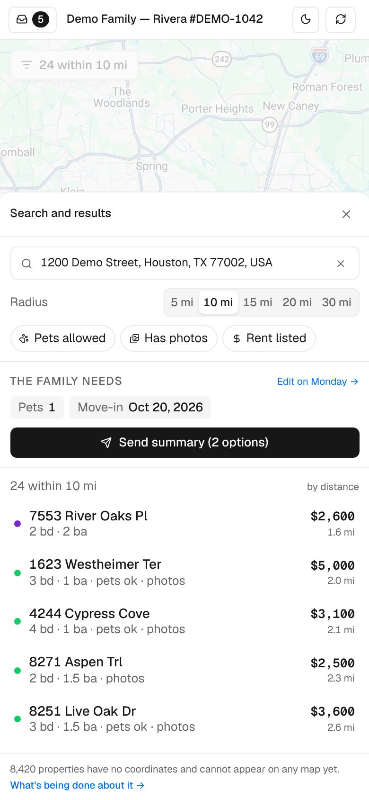
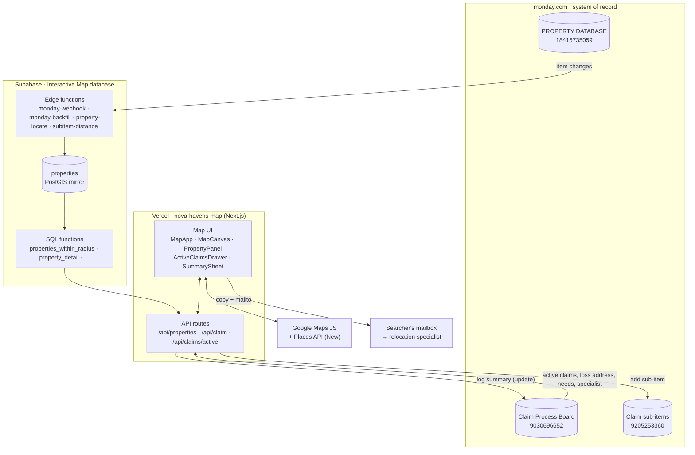
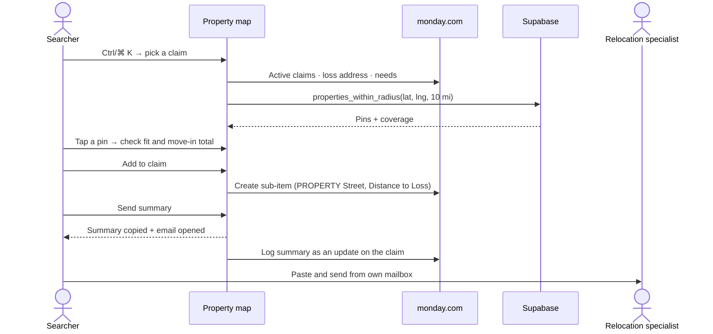

<div align="center">

# 🗺️ Nova Havens · Property Map

**Find temporary housing near a family's damaged home, shortlist it on the claim, and send it to the relocation specialist — in one screen.**

[](https://nova-havens-map.vercel.app)
[](https://nextjs.org)
[](https://react.dev)
[](https://ui.shadcn.com)
[](https://supabase.com/dashboard/project/nmandvqfuwvqxeabptjd)
[](https://novahavens-company.monday.com/boards/18415735059)
[-4285F4?logo=googlemaps&logoColor=white)](https://developers.google.com/maps/documentation/javascript)

[**Open the map**](https://nova-havens-map.vercel.app) · [▶ Watch the 77s tour](docs/video/property-map-launch.mp4) · [What's new](#-whats-new--october-2026) · [Using it](#-using-the-map) · [How it works](#-how-it-works) · [Run it locally](#-run-it-locally) · [Deploy](#-deploying) · [Troubleshooting](#-troubleshooting)

<br>

<picture>
  <source media="(prefers-color-scheme: dark)" srcset="docs/screenshots/hero-dark.jpg">
  
</picture>

<sub>All screenshots use fictional demo claims and properties.</sub>

<br>

<a href="docs/video/property-map-launch.mp4"></a>

<sub>▶ <b><a href="docs/video/property-map-launch.mp4">Watch the launch video</a></b> (77s, narrated with captions) · Pick → Find → Add → Send · <a href="video/">how it was made</a></sub>

</div>

---

> [!IMPORTANT]
> **The source is in this repo and `main` deploys to production.** The Next.js app at the root was recovered byte-for-byte from the 29 Sep 2026 CLI deployment (every file checked against Vercel's hashes), and everything since has shipped through pull requests. The retired AI Studio prototype lives in [`legacy/`](legacy/).

---

## ✨ What it does

Nova Havens places families displaced by insurance claims into temporary housing. When a claim comes in, a searcher needs to know **which of our ~15,700 properties are close to the damaged home, available, and a fit for the family** — then put the best ones on the claim and get them to the insurer's relocation specialist.

| | |
|---|---|
| 🗂️ **Active claims, one keystroke away** | **Ctrl/⌘ K** opens every claim waiting on housing options, with search, needs preview and how many options each already has. |
| 📍 **Loss-centred search** | Picking a claim centres the map on its *Damaged Residence Address* and shows every mapped property within 5–30 miles. |
| 🧮 **Fit at a glance** | Rent, beds/baths, pets, photos, fit against the family's needs, and a single **move-in total** (first month + every deposit and one-off fee). |
| ➕ **One-tap shortlist** | **Add to claim** creates the Monday sub-item on the claim you're working, with **Distance to Loss (mi)** filled in. The panel always says which claim you're adding to. |
| ✉️ **Send summary** | Builds a clean summary of every option on the claim, copies it, opens an email to the relocation specialist, and logs it on the Monday claim. |
| 🧪 **Safe local testing** | `MONDAY_DRY_RUN=1` stops every Monday write and shows a **Dry run** chip. |
| 🗺️ **Honest coverage** | Says how many properties can't be shown because they have no coordinates — nothing is silently hidden. |
| 🌗 **Light, dark, phone, desktop** | Follows the system theme (with a toggle) and works from 360 px up. |

---

## 🆕 What's new — October 2026

| | Change | PR |
|---|---|---|
| 📦 | **Live source recovered into the repo.** All 24 files of production deployment `dpl_6beu23Uhss23wPB2hEJVWqAkG74r` pulled from Vercel and verified against their blob hashes; prototype moved to `legacy/`; Vercel preset switched from Vite to Next.js. | [#5](https://github.com/Novahavens/Interactive-map/pull/5), [#6](https://github.com/Novahavens/Interactive-map/pull/6) |
| 🧪 | **Monday dry-run guard** (`MONDAY_DRY_RUN=1`), `GET /api/health`, and a *Dry run* chip in the header. | [#5](https://github.com/Novahavens/Interactive-map/pull/5) |
| 🗂️ | **Active Claims drawer** (shadcn Sheet + cmdk), **Ctrl/⌘ K**, claim switching without leaving the map, and **"Adding to: {claim}"** on the property panel. | [#6](https://github.com/Novahavens/Interactive-map/pull/6) |
| ✉️ | **Send summary** to the relocation specialist: preview, copy, email, and a log on the Monday claim. | [#7](https://github.com/Novahavens/Interactive-map/pull/7) |
| 🎨 | **shadcn/ui** added and themed through the existing design tokens, so new components match light and dark mode. | [#6](https://github.com/Novahavens/Interactive-map/pull/6) |
| 📍 | **Coordinates for the rest of the database.** `property-locate` places Furnished Finder listings from their own pages, street-only and near-miss addresses through Geocodio, and new Monday items within about a minute. Area-level pins are drawn dashed with **≈** and labelled *approximate* in the panel and the summary. | this PR |
| 📏 | **Distance to Loss on every option**, including the ones added by hand in Monday. `subitem-distance` fills the column within about a minute, or as soon as a brand-new property has coordinates. | this PR |

---

## 🧭 Using the map

### 1 · Pick a claim

Press **Ctrl/⌘ K** (or the **Claims** button, top left). The drawer lists every claim waiting on housing options — newest first — with the loss address, what the family needs and how many options are already attached. Type to filter by name or address; **Show test claims** adds the testing group.

<p align="center">
  
</p>

Picking a claim fills the search box with its loss address, recentres the map, loads the options already on it (black pins) and puts `?claimId=…` in the URL, so a refresh or a shared link opens the same claim. Opening the map from Monday with `?claimId=` does the same thing.

> [!NOTE]
> **"Active" means the claim is in the *New Housing Request* or *New Option Needed* group** on the Claim Process Board. That's set by `MONDAY_ACTIVE_CLAIM_GROUPS`, so the definition can change without a code change.

### 2 · Find the right home

1. **Pick a radius** — 5, 10 (default), 15, 20 or 30 mi.
2. **Narrow down** with *Pets allowed*, *Has photos*, *Rent listed*.
3. **Scan the list** (sorted by distance) or the pins. Numbered circles are clusters — zoom in to split them.
4. **Tap a property** to open its panel:
   - **Fit against this claim** — family size, pets, FRV and move-in date, each ticked, flagged or marked unknown.
   - **Cost to place** — monthly rent, every deposit and fee, and the **move-in total** (recurring pet rent is shown but excluded).
   - **Property, contacts, notes & links** — beds, baths, sq ft, type, availability, owner and landlord, listing, photo folder, *Open in Monday*.

| Pin | Meaning |
|---|---|
| 🟠 **Loss** | The damaged-residence address |
| 🟢 **Data Base** | Property in the main *Data Base* group |
| 🟣 **Preferred** | Property from a *Preferred Landlord* |
| 🔴 **Do not use** | In *DO NOT USE* — shown for context, can't be added |
| ⚫ **On this claim** | Already attached to the selected claim |

### 3 · Add it to the claim

**Add to claim** (bottom of the panel) creates one sub-item on the selected claim with status *Ready to Submit*, linked to the property and with *Distance to Loss (mi)* filled in. The pin turns black. One at a time is deliberate — it's the quality gate.

### 4 · Send the summary

When the claim has at least one option, **Send summary (N options)** appears under *The family needs*.

<p align="center">
  
</p>

- The preview shows exactly what the specialist will get: the loss address, the family's needs, then one block per option (nearest first) with rent, every fee, **move-in total**, distance, availability, listing and photo links. **Owner contacts are left out.**
- **Email {specialist}** copies the formatted summary, opens your email app addressed to the specialist with the subject filled in, and logs the summary as an update on the Monday claim. Paste and send.
- **Copy** just copies it, with nothing logged.

> [!TIP]
> Relocation specialists are external (CRS, ALE Solutions, Homelink…), so a Monday @mention can't reach them. The address comes from the claim's *Specialist Email* column — if it's blank, the sheet says so and you can still copy the summary.

### On a phone

<p align="center">
  
  &nbsp;
  
  &nbsp;
  
</p>

> [!TIP]
> A property only shows up if its **Full Address** in the Monday PROPERTY DATABASE has a location. The footnote under the list shows how many don't — fixing the address in Monday is what makes them appear.

---

## 🧱 How it works



- **Monday is the source of truth.** Nobody edits property or claim data in this app — it reads them, adds sub-items and posts updates.
- **Supabase is a read-optimised mirror** of the PROPERTY DATABASE, so "everything within 10 miles" is one PostGIS query instead of paging 15,000 Monday items.
- **Only the Next.js server holds secrets.** The browser talks to `/api/*`; those routes talk to Supabase and Monday.

<details>
<summary><b>A searcher's flow, end to end</b></summary>



</details>

### Tech stack

| Layer | What we use |
|---|---|
| App | **Next.js 15** (App Router) · **React 19** · **TypeScript 5.9** |
| UI | **Tailwind CSS 4** · **shadcn/ui** (Radix Dialog/Sheet, **cmdk** Command) · `lucide-react` · Geist |
| Map | `@googlemaps/js-api-loader` · Advanced Markers · `@googlemaps/markerclusterer` · Places API (New) |
| Data | `@supabase/supabase-js` (server-only) → Supabase Postgres + PostGIS |
| Integrations | monday.com GraphQL API (server-only) |
| Hosting | Vercel (team **Nova Havens**, project **nova-havens-map**, preset **Next.js**), Node 22 |

### Project structure

```text
.
├── app/
│   ├── layout.tsx · page.tsx · globals.css     # shell, ?claimId=, design tokens (+ shadcn mapping)
│   └── api/
│       ├── health/route.ts                     # GET  { ok, dryRun }
│       ├── properties/route.ts                 # GET  pins + coverage inside a radius
│       ├── properties/[id]/route.ts            # GET  full record for the side panel
│       ├── claims/active/route.ts              # GET  claims waiting on options (drawer)
│       ├── claim/[claimId]/route.ts            # GET  loss address, needs, attached options
│       ├── claim/[claimId]/summary/route.ts    # GET  summary preview · POST log it on the claim
│       └── claim/add/route.ts                  # POST attach a property (Monday sub-item)
├── components/
│   ├── MapApp.tsx                # page shell: header, claim state, filters, list
│   ├── MapCanvas.tsx             # Google map, markers, clustering, radius circle
│   ├── PropertyPanel.tsx         # property detail + "Adding to" + Add to claim
│   ├── SearchBox.tsx             # Places (New) autocomplete
│   ├── ActiveClaimsDrawer.tsx    # Ctrl/⌘ K drawer (shadcn Sheet + cmdk)
│   ├── SummarySheet.tsx          # Send summary preview / copy / email
│   └── ui/                       # shadcn/ui: sheet, dialog, command, button
├── lib/
│   ├── monday.ts                 # server-only Monday client, columns, dry-run guard
│   ├── summary.ts                # pure buildSummary() + parseEmails()
│   ├── supabase.ts · google.ts · types.ts · utils.ts · useTheme.ts
├── supabase/                     # property-locate function + migrations
├── docs/                         # PRD, build plan, screenshots
├── legacy/                       # retired AI Studio prototype (reference only)
├── components.json               # shadcn/ui config
└── vercel.json · next.config.ts · .env.example
```

### API routes

| Route | Returns | Backed by |
|---|---|---|
| `GET /api/health` | `{ ok, dryRun }` | env |
| `GET /api/properties?lat=&lng=&miles=` | `{ pins, coverage }` | `properties_within_radius`, `radius_coverage` |
| `GET /api/properties/[id]` | Full property record | `property_detail` |
| `GET /api/claims/active?q=&includeTest=&fresh=` | `{ claims, count }` — cached 60 s per instance | Monday `items_page` / `next_items_page` per group |
| `GET /api/claim/[claimId]` | Loss address, needs, attached options + pins | Monday + `properties_by_ids` |
| `GET /api/claim/[claimId]/summary` | `{ subject, text, html, optionCount, recipient }` | Monday + `property_detail` + `property_distance_miles` |
| `POST /api/claim/[claimId]/summary` | Logs the summary as a Monday update (body rebuilt server-side) | Monday `create_update` |
| `POST /api/claim/add` | Creates the linked sub-item with *Distance to Loss* | Monday + `property_distance_miles` |

---

## 📚 Data sources

### monday.com boards

| Board | ID | Role |
|---|---|---|
| [PROPERTY DATABASE](https://novahavens-company.monday.com/boards/18415735059) | `18415735059` | Every property: location, type, beds/baths, rent and fees, pets, owner, photos, notes. Groups: *Data Base*, *Preferred Landlord*, *DO NOT USE*. |
| [Claim Process Board](https://novahavens-company.monday.com/boards/9030696652) | `9030696652` | One item per claim. Used here: *Damaged Residence Address*, family needs, *Current Status*, *Relocation Specialist* + *Specialist Email*, and the groups *New Housing Request* / *New Option Needed* (active) and the testing group. |
| Subitems of Claim Process Board | `9205253360` | The options on a claim — linked via *PROPERTY Street*, with *Distance to Loss (mi)*. |
| Landlord board | `9616452671` | Owner/landlord contacts and approval status (resolved into the Supabase mirror). |

### Supabase — *Interactive Map database* (`nmandvqfuwvqxeabptjd`)

| Object | What it is |
|---|---|
| `properties` (table) | Mirror of the property board, keyed by `monday_item_id`, with generated PostGIS `geom` and `move_in_total`. RLS on, no policies — reachable only through the functions below. |
| `properties_within_radius_v2`, `radius_coverage`, `database_coverage` | Pin layer (with an `approximate` flag per pin) and coverage counts. |
| `property_detail`, `properties_by_ids`, `property_distance_miles` | Panel record, attached pins, *Distance to Loss*. |
| `monday-webhook`, `monday-backfill` | Keep the mirror in sync with Monday within seconds. |
| `property-locate` + `locate_sweep()` | Fill in coordinates for anything unmapped and write them back to Monday (see below). |
| `locate_candidates`, `locate_needs_review` (views) | What the locator will try next; what only a person can fix. |
| `subitem-distance` + `subitem_distance_sweep()` | Fill *Distance to Loss (mi)* on claim options however they were added (see below). |

### How a property gets its pin

| Board has… | Route | Pin |
|---|---|---|
| A *Full Address* (location column) | Mirrored by `monday-webhook` | Exact, on the map within ~2 s |
| A numbered street + zip or city/state | US Census geocoder, Geocodio if Census misses | Exact |
| A street with no number, or a Zillow / Trulia / Redfin link | Geocodio | Exact, or **≈ approximate** (street centre) |
| A Furnished Finder listing ID or link | The listing's own page via Firecrawl | **≈ approximate** (the site never shows the street) |
| Nothing locational | — | Listed in `locate_needs_review` for the team |

New or edited unmapped items start a run straight away (row trigger), with a 30-second cron as a safety net, so they reach the map in about a minute. Every pin is written to Monday's location column, so Monday stays the source of truth; a row that fails is retried only after someone edits it on the board. Needs the `FIRECRAWL_API_KEY` and `GEOCODIO_API_KEY` edge-function secrets.

### How an option gets its Distance to Loss

**Add to claim** writes it when the sub-item is created. Most options are added by hand in Monday, so two webhooks on the claim board (`create_subitem`, `change_subitem_column_value`) queue every new option, and every option whose property is changed, in `subitem_distance`. A 30-second cron (`subitem_distance_sweep()`) measures each one with `property_distance_miles` (the same straight-line figure the map uses) once both ends are known, and writes the column:

| Option's state | What happens |
|---|---|
| Linked property and claim loss address both on the map | Written within about a minute |
| Property just created, not located yet | Waits in Supabase (no Monday calls) and is written once `property-locate` places it |
| Claim has no loss address | Checked hourly for a week |
| Column already has a figure | Left alone, unless the option's property is changed, which recomputes it |

The webhook URL carries the `SUBITEM_HOOK_KEY` from `sync_config`. Nothing polls Monday: the account's API allows 10,000 calls a day.

---

## 💻 Run it locally

**You need:** Node.js **22**, npm, and the environment variables below.

```bash
git clone https://github.com/Novahavens/Interactive-map.git
cd Interactive-map
npm install
cp .env.example .env.local   # fill in the values; MONDAY_DRY_RUN=1 is already set
npm run dev                  # http://localhost:3000
```

> [!CAUTION]
> Keep **`MONDAY_DRY_RUN=1`** locally. With it on, *Add to claim* and *Send summary* log what they would send instead of writing to the real Monday boards, and a **Dry run** chip shows in the header. Reads still hit Monday.

| Script | Does |
|---|---|
| `npm run dev` | Dev server with hot reload |
| `npm run build` | Production build (also type-checks) |
| `npm run start` | Serve the production build |
| `npm run typecheck` | `tsc --noEmit` |

### Environment variables

| Variable | Where | Notes |
|---|---|---|
| `NEXT_PUBLIC_GOOGLE_MAPS_API_KEY` | Browser | Maps JS + Places (New). **Public by design — must be referrer-restricted.** |
| `NEXT_PUBLIC_GOOGLE_MAPS_MAP_ID` | Browser | For Advanced Markers. `DEMO_MAP_ID` works for testing only. |
| `SUPABASE_URL` · `SUPABASE_KEY` | Server | Project URL and publishable key. |
| `MONDAY_API_TOKEN` | Server | Sub-items and updates are created **as the token's owner**. |
| `MONDAY_PROPERTY_BOARD_ID` · `MONDAY_CLAIM_BOARD_ID` · `MONDAY_CLAIM_SUBITEM_BOARD_ID` | Server | `18415735059` · `9030696652` · `9205253360` |
| `MONDAY_DRY_RUN` | Server | `1` = never write to Monday. **Local only — never set in Production.** |
| `MONDAY_ACTIVE_CLAIM_GROUPS` | Server | Optional. Groups that count as active. Default `topics,group_mkvngrgz`. |
| `MONDAY_TEST_CLAIM_GROUP` | Server | Optional. The testing group for *Show test claims*. Default `group_mm1jnpwf`. |

Production and Preview already have everything they need on Vercel. Never commit `.env.local`.

---

## 🚀 Deploying

Hosting is **Vercel** → team *Nova Havens* → project **[nova-havens-map](https://vercel.com/nova-havens/nova-havens-map)** (framework preset **Next.js**), connected to this repo.

| You do | Vercel does |
|---|---|
| Push a branch / open a PR | Builds a **preview** (Vercel login required to view) |
| Merge to `main` | Builds and promotes to **production** — [nova-havens-map.vercel.app](https://nova-havens-map.vercel.app) |
| Change an environment variable | Nothing until the next deploy — `NEXT_PUBLIC_*` values are baked in at build time. *Redeploy*. |
| Need to undo | *Deployments → ⋯ → Instant Rollback* |

> [!WARNING]
> Previews use the real `MONDAY_API_TOKEN`, so *Add to claim* and *Send summary* on a preview write to real claims. Test on a claim in the testing group, or add `MONDAY_DRY_RUN=1` to the **Preview** environment only.

### Google Maps setup

1. Enable **[Maps JavaScript API](https://console.cloud.google.com/apis/library/maps-backend.googleapis.com)** and **[Places API (New)](https://console.cloud.google.com/apis/library/places.googleapis.com)**.
2. On the key: **Website restrictions** `https://nova-havens-map.vercel.app/*`, `https://nova-havens-map-nova-havens.vercel.app/*`, `https://nova-havens-map-git-main-nova-havens.vercel.app/*`, `http://localhost:3000/*`; **API restrictions** to those two APIs only.
3. Link **billing**, or the map shows *"For development purposes only"*.
4. *(Recommended)* create a real **Map ID** and set `NEXT_PUBLIC_GOOGLE_MAPS_MAP_ID`.

### Embedding in Monday

The app sends `Content-Security-Policy: frame-ancestors 'self' https://*.monday.com`, so it can live inside Monday:

```text
https://nova-havens-map.vercel.app/?claimId={claim item id}
```

`claim_id` and `itemId` work as aliases. Without an ID the map opens with the claims drawer one keystroke away.

---

## 🔐 Security & access

| Thing | Exposure | What protects it |
|---|---|---|
| Production URL | Anyone with the link | `noindex`; share internally only — it shows owner contacts and can add options to claims. |
| Google Maps key | In the page | Website restriction above — keep it in place. |
| `MONDAY_API_TOKEN` | Server only (Vercel *Sensitive*) | Rotate in Monday → Developers if it leaks, update Vercel, redeploy. |
| `SUPABASE_KEY` | Server only | Table is RLS-locked; functions are `SECURITY DEFINER`. Hardening option: service-role key + revoke `anon`. |
| Summary email | Searcher's own mailbox | Built server-side from Monday + Supabase; owner contacts excluded; preview rendered in a sandboxed frame. |

---

## 🩺 Troubleshooting

| Symptom | Likely cause | Fix |
|---|---|---|
| Grey map / "Oops! Something went wrong" | Key missing or domain not allowed (`RefererNotAllowedMapError`) | Add the domain to the key's website list; check the env var; redeploy |
| Address search shows nothing | Places API (New) not enabled/allowed | Enable it and allow it on the key |
| A property isn't on the map | The locator couldn't place it | `select * from locate_needs_review` shows why; fix the name / city / zip / link in Monday and it is retried within a minute |
| Pin is dashed with **≈** | Placed from a listing page or a street centre | Confirm the street with the host and enter it in *Full Address* |
| Claims drawer is empty | No claims in the active groups, or the groups changed | Check the board; adjust `MONDAY_ACTIVE_CLAIM_GROUPS` |
| **Add to claim** is greyed out | No claim selected, or the property is *DO NOT USE* | Ctrl/⌘ K → pick a claim |
| **Send summary** is greyed out | The claim has no options yet | Add at least one |
| "No specialist email on the claim" | *Relocation Specialist* not linked on the claim | Link the specialist in Monday, or copy and send manually |
| Nothing appears in Monday after adding | `MONDAY_DRY_RUN=1` is on (look for the chip) | Expected locally; unset it only where real writes are intended |
| Adding/logging fails | `MONDAY_API_TOKEN` expired | Update it in Vercel → *Redeploy* |
| An option has no *Distance to Loss* | Its property or its claim isn't on the map yet | `select * from subitem_distance where subitem_id = '…'` shows what it's waiting for |

---

## 📌 Roadmap

**Shipped**
- [x] Live source in the repo, Vercel on Next.js, prototype retired ([#5](https://github.com/Novahavens/Interactive-map/pull/5), [#6](https://github.com/Novahavens/Interactive-map/pull/6))
- [x] Monday dry-run guard ([#5](https://github.com/Novahavens/Interactive-map/pull/5))
- [x] Active claims drawer + claim-scoped Add to claim ([#6](https://github.com/Novahavens/Interactive-map/pull/6))
- [x] Summary to the relocation specialist ([#7](https://github.com/Novahavens/Interactive-map/pull/7))
- [x] Coordinates for the rest of the database, and new items on the map within a minute

**Next**
- [ ] **Coverage badge** — the header mixes in-radius and table-wide counts; switch it to `database_coverage()`.
- [ ] **Grey out claims that already have options sent** in the drawer.
- [ ] **Call / Text via Quo** and a one-line option summary (placeholders already in the property panel).
- [ ] **Availability** and **last-used date** on the property card.
- [ ] **Search agent** embed.
- [ ] Real Google **Map ID**; optional server-only Supabase access.

---

## 🧪 Legacy prototype

[`legacy/`](legacy/) holds the **1 Sep 2026 AI Studio prototype** (Vite + Lit, sample data only). It's excluded from builds and kept for reference — the travel-time calculator and internal-notes editor are ideas worth porting.

---

<div align="center">

Built for the Nova Havens Tech Team · owned by **Fazal Abed**

</div>
