<div align="center">

# 🗺️ Nova Havens · Property Map

**Find temporary housing near a family's damaged home, shortlist it on the claim, and send it to the relocation specialist — in one screen.**

[](https://nova-havens-map.vercel.app)
[](https://nextjs.org)
[](https://react.dev)
[](https://ui.shadcn.com)
[](https://supabase.com/dashboard/project/nmandvqfuwvqxeabptjd)
[](https://novahavens-company.monday.com/boards/18415735059)
[-4285F4?logo=googlemaps&logoColor=white)](https://developers.google.com/maps/documentation/javascript)

[**Open the map**](https://nova-havens-map.vercel.app) · [▶ Watch the 77s tour](https://nova-havens-map.vercel.app/video/property-map-launch.mp4) · [What's new](#-whats-new--october-2026) · [Using it](#-using-the-map) · [How it works](#-how-it-works) · [Run it locally](#-run-it-locally) · [Deploy](#-deploying) · [Troubleshooting](#-troubleshooting)

<br>

<picture>
  <source media="(prefers-color-scheme: dark)" srcset="docs/screenshots/hero-dark.jpg">
  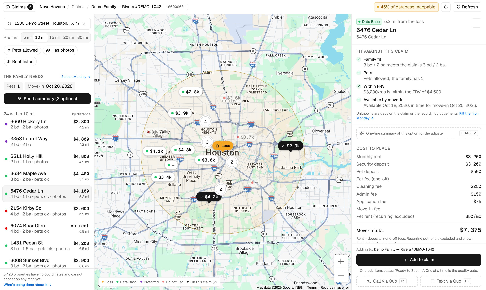
</picture>

<sub>All screenshots use fictional demo claims and properties.</sub>

<br>

<a href="https://nova-havens-map.vercel.app/video/property-map-launch.mp4">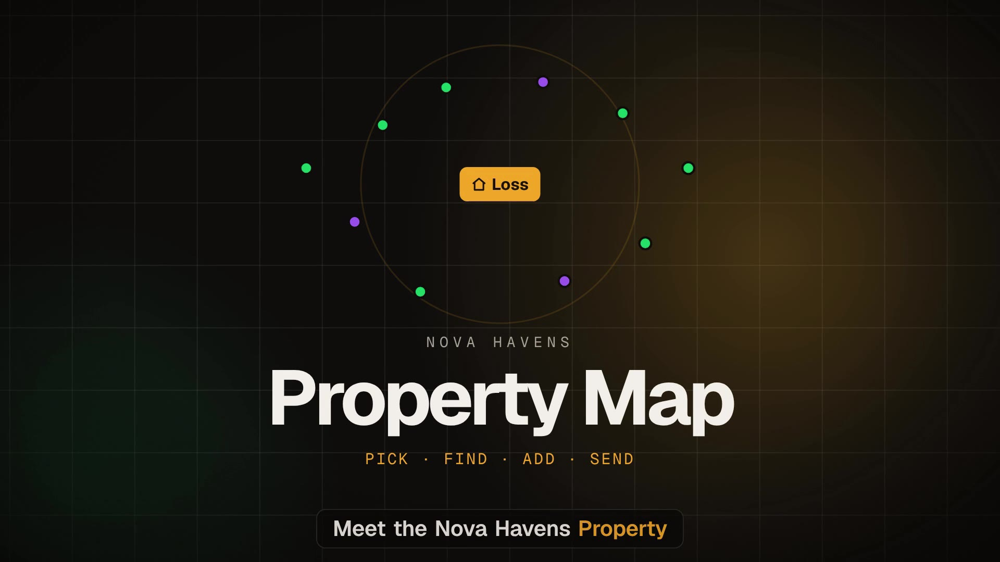</a>

<sub>▶ <b><a href="https://nova-havens-map.vercel.app/video/property-map-launch.mp4">Watch the launch video</a></b> (77s, narrated with captions) · Pick → Find → Add → Send · <a href="video/">how it was made</a></sub>

</div>

---

> [!IMPORTANT]
> **The source is in this repo and `main` deploys to production.** The Next.js app at the root was recovered byte-for-byte from the 29 Sep 2026 CLI deployment (every file checked against Vercel's hashes), and everything since has shipped through pull requests. The retired AI Studio prototype lives in [`legacy/`](legacy/).

---

## ✨ What it does

Nova Havens places families displaced by insurance claims into temporary housing. When a claim comes in, a searcher needs to know **which of our ~15,700 properties are close to the damaged home, available, and a fit for the family** — then put the best ones on the claim and get them to the insurer's relocation specialist.

| | |
|---|---|
| 🗂️ **Active claims, one keystroke away** | **Ctrl/⌘ K** opens every claim waiting on housing options, with search, needs preview and how many options each already has. |
| 📍 **Loss-centred search** | Picking a claim centres the map on its *Damaged Residence Address* and shows every mapped property within 5–30 miles. |
| 🚦 **Every property has a colour** | **Green** = we've used them before (or they're marked Preferred), **neutral** (yellow) = in the database, no history, **red** = do not use. Never blank, never a fourth colour. |
| 📋 **Claim information on the map** | The claim's status, dates, family, needs, special requests and who's working it, in a collapsible card, without leaving the map. |
| 🧮 **Fit at a glance** | Rent, beds/baths, pets, photos, fit against the family's needs, and a single **move-in total** (first month + every deposit and one-off fee). |
| ➕ **One-tap shortlist** | **Add to claim** creates the Monday sub-item on the claim you're working, with **Distance to Loss (mi)** filled in. The panel always says which claim you're adding to. |
| ✉️ **Send summary** | Builds a clean summary of every option on the claim, copies it, opens an email to the relocation specialist, and logs it on the Monday claim. |
| 🧪 **Safe local testing** | `MONDAY_DRY_RUN=1` stops every Monday write and shows a **Dry run** chip. |
| 🗺️ **Honest coverage** | Says how many properties can't be shown because they have no coordinates — nothing is silently hidden. |
| 🌗 **Light, dark, phone, desktop** | Follows the system theme (with a toggle) and works from 360 px up. |

---

## 🆕 What's new — October 2026

| | Change | PR |
|---|---|---|
| 📦 | **Live source recovered into the repo.** All 24 files of production deployment `dpl_6beu23Uhss23wPB2hEJVWqAkG74r` pulled from Vercel and verified against their blob hashes; prototype moved to `legacy/`; Vercel preset switched from Vite to Next.js. | [#5](https://github.com/Novahavens/Interactive-map/pull/5), [#6](https://github.com/Novahavens/Interactive-map/pull/6) |
| 🧪 | **Monday dry-run guard** (`MONDAY_DRY_RUN=1`), `GET /api/health`, and a *Dry run* chip in the header. | [#5](https://github.com/Novahavens/Interactive-map/pull/5) |
| 🗂️ | **Active Claims drawer** (shadcn Sheet + cmdk), **Ctrl/⌘ K**, claim switching without leaving the map, and **"Adding to: {claim}"** on the property panel. | [#6](https://github.com/Novahavens/Interactive-map/pull/6) |
| ✉️ | **Send summary** to the relocation specialist: preview, copy, email, and a log on the Monday claim. | [#7](https://github.com/Novahavens/Interactive-map/pull/7) |
| 🎨 | **shadcn/ui** added and themed through the existing design tokens, so new components match light and dark mode. | [#6](https://github.com/Novahavens/Interactive-map/pull/6) |
| 📍 | **Coordinates for the rest of the database.** `property-locate` places Furnished Finder listings from their own pages, street-only and near-miss addresses through Geocodio, and new Monday items within about a minute. Area-level pins are drawn dashed with **≈** and labelled *approximate* in the panel and the summary. | [#10](https://github.com/Novahavens/Interactive-map/pull/10) |
| 🚦 | **Green, yellow and red dots.** Every one of the 16,384 properties is exactly one colour, decided in one place (the database). Green is an owner we've placed a tenant with (read from claims), or Preferred / Approved on the owner board; red is do not use by group or by owner and always wins. Each colour has its own shape, there's a legend that also filters, and green is listed first. | [#13](https://github.com/Novahavens/Interactive-map/pull/13) |
| 📋 | **Claim information card** and an owner-status banner with the reason and notes at the top of the property panel. Tenant phone and email are deliberately left out: the map URL has no login. | [#13](https://github.com/Novahavens/Interactive-map/pull/13) |
| 🔔 | **Owner changes reach the map in seconds.** A webhook on the owner board re-reads every property an owner has, so changing someone to Preferred or DO NOT USE changes their dots straight away. | [#13](https://github.com/Novahavens/Interactive-map/pull/13) |
| 🟢 | **Live status on every property.** *Available now / soon / unverified / unavailable / listing removed* from the availability monitor, **"On claim …"** when the property is already an option on another active claim (with the status), **Last contact** date, and **Bad link**. Add to claim warns before adding a property that is an option elsewhere. | [#14](https://github.com/Novahavens/Interactive-map/pull/14) |
| 🔗 | **Report bad link** from the property panel: one click sets *ZZ.Status = BAD LINK* on the property, posts a note on it saying who reported it, and the map shows it straight away. Rate-limited and once per property per day. | [#14](https://github.com/Novahavens/Interactive-map/pull/14) |
| 🖱️ | **Hover a result, see its pin.** The pin grows and the map pans to it; hovering a pin highlights the row. The legend now explains the ⚫ check and the numbered clusters. The account manager shows on the claims list and the panel. | [#14](https://github.com/Novahavens/Interactive-map/pull/14) |
| 📞 | **Contact history from Quo on the owner card.** Last call (date, who, length or no answer), how many calls and how many went unanswered, texts sent and replies, and the last text, across the owner's and landlord/PM's numbers and every Quo inbox. Read-only; appears once `QUO_API_KEY` is set. Also: a **Filters** drawer, and beds / baths / rent / pets first in the panel. | [#15](https://github.com/Novahavens/Interactive-map/pull/15) |
| ☎️ | **Call and Text from the panel, through your own Quo.** Each owner and landlord/PM number has a **Call** and a **Text** button that open Quo on *your* laptop or phone, so the call or text goes from your Quo account and lands in the contact history. The text comes pre-written ("Hi Jane, it's Will from Nova Havens about 12 Elm St."). Tap the number to copy it. No set-up in the map: the device you're on is who you are. | [#16](https://github.com/Novahavens/Interactive-map/pull/16) |
| 📱 | **Phone results sheet** with collapsed / half / expanded states: the list gets most of the screen, search and filters fold into one row, and the sheet and the list no longer fight over scrolling. The desktop rail no longer squeezes the list to a few pixels at short windows (Lou's scroll bug). | [#14](https://github.com/Novahavens/Interactive-map/pull/14) |
| 🛠️ | **Fixes:** new options now arrive as **To Do** (not *Ready to Submit*); the claim's bedroom and bathroom needs were read from each other's columns; "% of database mappable" counted only the search circle; red properties can't be added to a claim whether the group *or* the owner says do not use. | [#13](https://github.com/Novahavens/Interactive-map/pull/13) |

---

## 🧭 Using the map

### 1 · Pick a claim

Press **Ctrl/⌘ K** (or the **Claims** button, top left). The drawer lists every claim waiting on housing options — newest first — with the loss address, what the family needs and how many options are already attached. Type to filter by name or address; **Show test claims** adds the testing group.

<p align="center">
  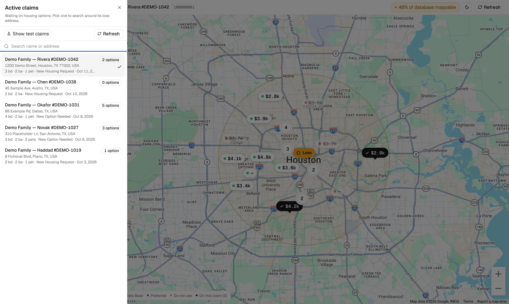
</p>

Picking a claim fills the search box with its loss address, recentres the map, loads the options already on it (black pins) and puts `?claimId=…` in the URL, so a refresh or a shared link opens the same claim. Opening the map from Monday with `?claimId=` does the same thing.

> [!NOTE]
> **"Active" means the claim is in the *New Housing Request* or *New Option Needed* group** on the Claim Process Board. That's set by `MONDAY_ACTIVE_CLAIM_GROUPS`, so the definition can change without a code change.

### 2 · Find the right home

1. **Pick a radius** — 5, 10 (default), 15, 20 or 30 mi.
2. **Narrow down** with *Pets allowed*, *Has photos*, *Rent listed*.
3. **Scan the list** (green first, then nearest) or the pins. **Hover a row and its pin grows and the map pans to it**; hover a pin and the row lights up. Numbered circles are clusters — zoom in to split them. The three colour chips under the filters show how many of each are in view and hide or show them.
   Each row also carries what's known right now:

   | Chip | Means |
   |---|---|
   | **Available now / soon**, *Unverified*, **Unavailable**, ~~Listing removed~~ | The availability monitor's last answer for the listing |
   | **On claim Smith — #1234 · Option Submitted** | Already an option on another active claim (on 2+ claims it says so). Add to claim asks "Add anyway?" |
   | **Bad link** | The listing link is dead (reported from the map, or by the monitor) |
   | Last contact Oct 5 | *Last Contact Date* on the property |
4. **Tap a property** to open its panel:
   - **Status banner** — the dot colour and *why*, with the same chips as the list and an **Other claims** list ("The owner is marked Preferred", "We have placed a tenant with this owner before", "In the DO NOT USE group"), plus the owner's approval note and the property's notes.
   - **Fit against this claim** — family size, pets, FRV and move-in date, each ticked, flagged or marked unknown.
   - **Cost to place** — monthly rent, every deposit and fee, and the **move-in total** (recurring pet rent is shown but excluded).
   - **Property, contacts, notes & links** — beds, baths, sq ft, type, availability, owner and landlord, listing, photo folder, *Open in Monday*.
   - **Contact history (Quo)** — a drawer on the owner card, closed until you tap it (Quo is only asked when it's opened). Inside: *Last call Oct 24 · William · 3 min*, *3 calls · 1 unanswered*, *4 sent · 1 reply*, and the last text (*They texted Oct 25: "Yes, it's free from Nov 1"*). It covers both the owner's and the landlord/PM's numbers and every Quo inbox. "No calls or texts in Quo yet" when there's nothing; counts end in **+** when Quo has more history than the map reads (200 calls or texts per number). Once loaded it stays loaded while the panel is open, and it is up to 10 minutes behind Quo. Without a Quo key there's no drawer.

     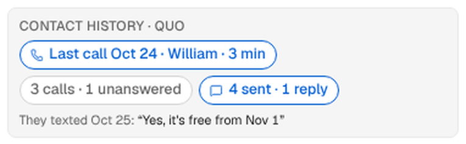

   - **Call · Text** — next to each owner and landlord/PM number. They open **Quo on the device you're using**, signed in as you, so the call or text goes from your own Quo number and shows up in the contact history above. *Text* opens Quo's composer with a first line already typed: *Hi Jane, it's Will from Nova Havens about 12 Elm St.* (your name comes from the one you typed into *Report bad link*; without it, "this is Nova Havens"). Tap the number itself to copy it.
     - **On a phone** (iPhone or Android with the Quo app): both buttons open Quo straight to the dialer or the composer. Without the app, the store opens.
     - **On a laptop**: *Call* uses Quo's click-to-call, so [make Quo your default calling app](https://support.quo.com/core-concepts/calling/click-to-call) once (Mac: FaceTime → Settings → *Default for calls* → Quo; Windows: Settings → Default apps → TEL → Quo). *Text* opens the Quo desktop app and also copies the number, so if the composer comes up empty, paste. If Quo doesn't take over within a couple of seconds the panel says so with a link to the fix.

     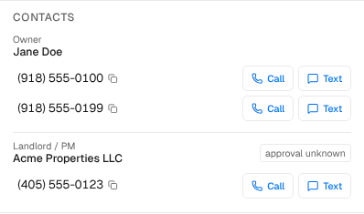

   - **Report bad link** — next to the listing link. Type your name once (remembered on your device), optionally what's wrong, Send. The property gets *ZZ.Status = BAD LINK* and a note on Monday, the link is struck through on the map, and properties@ is told by the Monday automation on that status.

| Dot | Meaning |
|---|---|
| 🟢 **Used before** (circle) | We've placed a tenant with this owner, or they're marked Preferred / Approved, or the property is in the Preferred group |
| 🟡 **Neutral** (diamond) | In the database, no history with us |
| 🔴 **Do not use** (square) | The group or the owner is DO NOT USE. Shown for context, can't be added to a claim |
| 🟠 **Loss** | The damaged-residence address |
| ⚫ **On this claim** | Already attached to the selected claim |
| 🔘 **7** | Several properties close together: zoom in to split them |

The shapes are there so the three read apart without relying on red versus green.

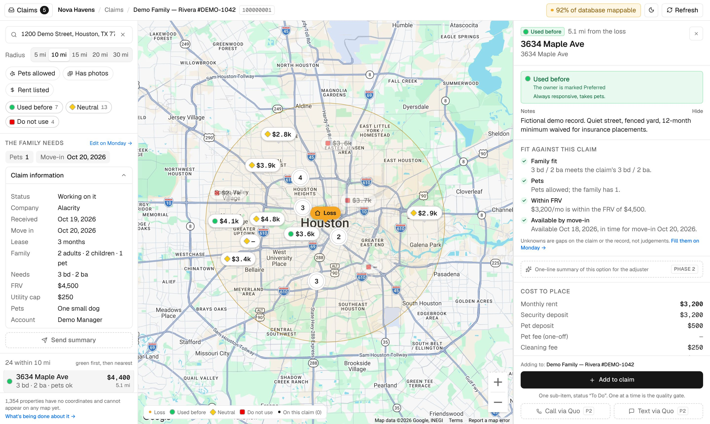

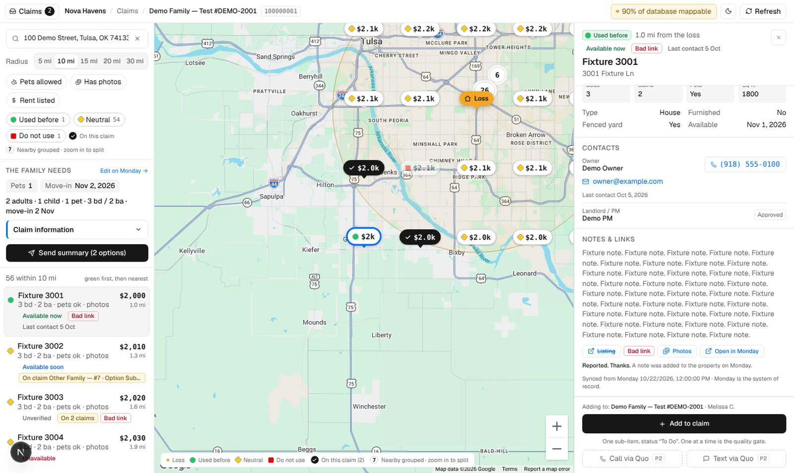

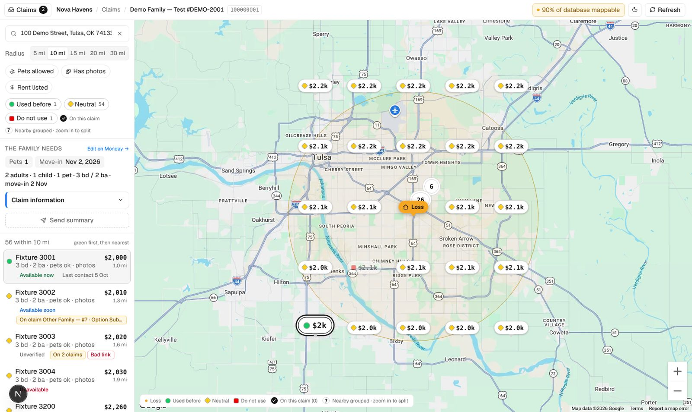

**The family at a glance** sits above the list on every screen ("2 adults · 1 child · 1 pet · 3 bd / 2 ba · move-in Nov 2"), and the claims list and the panel show the claim's **account manager**. **Claim information** (collapsible, under *The family needs*) shows the claim's status, company, dates, lease length, family, bedrooms and bathrooms needed, FRV, utility cap, pet description, notes and special requests, and the account manager, searcher and coordinator. It never shows the tenant's or owner's phone or email.

### 3 · Add it to the claim

**Add to claim** (bottom of the panel) creates one sub-item on the selected claim with status *To Do* (never *Ready to Submit*: a new option hasn't been vetted yet), linked to the property and with *Distance to Loss (mi)* filled in. The pin turns black. One at a time is deliberate — it's the quality gate.

**Distance to Loss (mi)** (column `numeric_mm7np0z7` on the sub-item board) is the same "X mi from the loss" figure the panel shows: the straight-line distance from the claim's loss address to the property, to two decimals. It's written when the map creates the option.
- It's left blank if the claim has no loss address in Monday, or the property isn't on the map yet.
- Options added by hand in Monday aren't touched. Their distance is whatever the person enters.

### 4 · Send the summary

When the claim has at least one option, **Send summary (N options)** appears under *The family needs*.

<p align="center">
  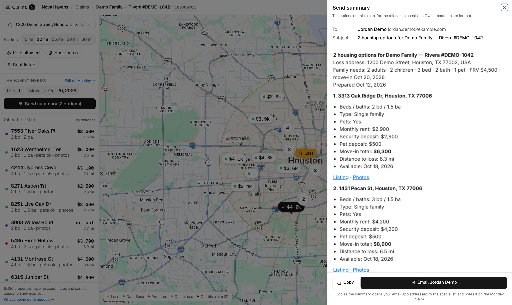
</p>

- The preview shows exactly what the specialist will get: the loss address, the family's needs, then one block per option (nearest first) with rent, every fee, **move-in total**, distance, availability, listing and photo links. **Owner contacts are left out.**
- **Email {specialist}** copies the formatted summary, opens your email app addressed to the specialist with the subject filled in, and logs the summary as an update on the Monday claim. Paste and send.
- **Copy** just copies it, with nothing logged.

> [!TIP]
> Relocation specialists are external (CRS, ALE Solutions, Homelink…), so a Monday @mention can't reach them. The address comes from the claim's *Specialist Email* column — if it's blank, the sheet says so and you can still copy the summary.

### On a phone

The results live in a bottom sheet with three heights: a **peek bar** with the count and the family line, **half** (the map stays usable above it) and **expanded** (the list takes about 80% of the screen). Drag the handle or swipe the list at its top; search, radius and filters fold into one row with a chevron; Claim information stays closed until you open it.

<p align="center">
  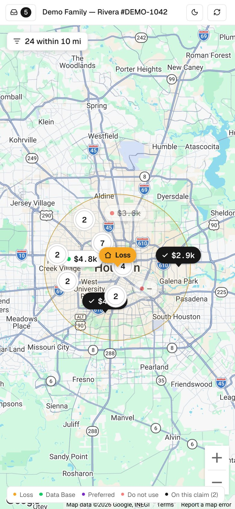
  &nbsp;
  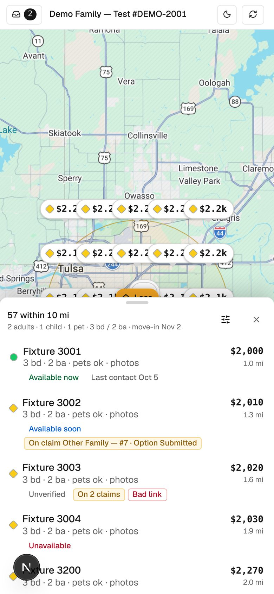
  &nbsp;
  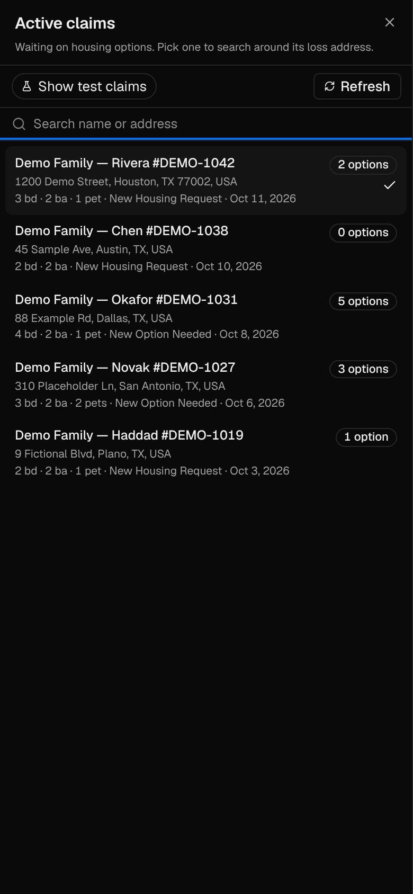
</p>

> [!TIP]
> A property only shows up if its **Full Address** in the Monday PROPERTY DATABASE has a location. The footnote under the list shows how many don't — fixing the address in Monday is what makes them appear.

---

## 🧱 How it works

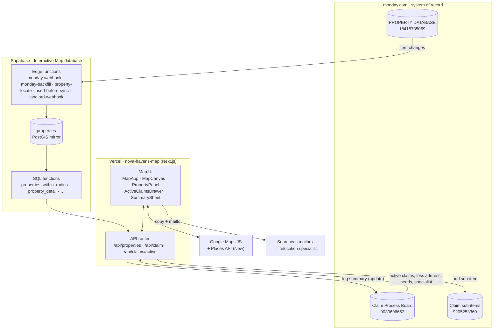

- **Monday is the source of truth.** Nobody edits property or claim data in this app — it reads them, adds sub-items and posts updates.
- **Supabase is a read-optimised mirror** of the PROPERTY DATABASE, so "everything within 10 miles" is one PostGIS query instead of paging 15,000 Monday items.
- **Only the Next.js server holds secrets.** The browser talks to `/api/*`; those routes talk to Supabase and Monday.

<details>
<summary><b>A searcher's flow, end to end</b></summary>

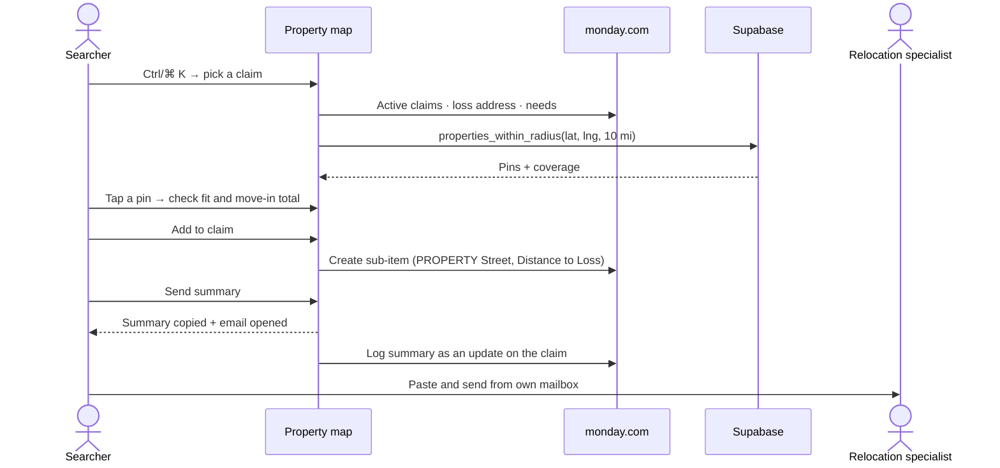

</details>

### Tech stack

| Layer | What we use |
|---|---|
| App | **Next.js 15** (App Router) · **React 19** · **TypeScript 5.9** |
| UI | **Tailwind CSS 4** · **shadcn/ui** (Radix Dialog/Sheet, **cmdk** Command) · `lucide-react` · Geist |
| Map | `@googlemaps/js-api-loader` · Advanced Markers · `@googlemaps/markerclusterer` · Places API (New) |
| Data | `@supabase/supabase-js` (server-only) → Supabase Postgres + PostGIS |
| Integrations | monday.com GraphQL API (server-only) |
| Hosting | Vercel (team **Nova Havens**, project **nova-havens-map**, preset **Next.js**), Node 22 |

### Project structure

```text
.
├── app/
│   ├── layout.tsx · page.tsx · globals.css     # shell, ?claimId=, design tokens (+ shadcn mapping)
│   └── api/
│       ├── health/route.ts                     # GET  { ok, dryRun }
│       ├── properties/route.ts                 # GET  pins + coverage inside a radius
│       ├── properties/[id]/route.ts            # GET  full record for the side panel
│       ├── claims/active/route.ts              # GET  claims waiting on options (drawer)
│       ├── claim/[claimId]/route.ts            # GET  loss address, needs, attached options
│       ├── claim/[claimId]/summary/route.ts    # GET  summary preview · POST log it on the claim
│       └── claim/add/route.ts                  # POST attach a property (Monday sub-item)
├── components/
│   ├── MapApp.tsx                # page shell: header, claim state, filters, list
│   ├── MapCanvas.tsx             # Google map, markers, clustering, radius circle
│   ├── PropertyPanel.tsx         # property detail, status banner, "Adding to" + Add to claim
│   ├── StatusDot.tsx · StatusLegend.tsx   # the one dot (colour + shape) and the legend / colour filter
│   ├── ClaimBrief.tsx            # collapsible claim information card
│   ├── SearchBox.tsx             # Places (New) autocomplete
│   ├── ActiveClaimsDrawer.tsx    # Ctrl/⌘ K drawer (shadcn Sheet + cmdk)
│   ├── SummarySheet.tsx          # Send summary preview / copy / email
│   └── ui/                       # shadcn/ui: sheet, dialog, command, button
├── lib/
│   ├── monday.ts                 # server-only Monday client, columns, dry-run guard
│   ├── summary.ts                # pure buildSummary() + parseEmails()
│   ├── contact.ts · quo.ts       # Quo contact history: pure digest rules, server-only client (docs/QUO-INTEGRATION.md)
│   ├── quo-links.ts              # openphone:// and tel: links for the Call / Text buttons, the text draft
│   ├── status.ts                 # green / yellow / red: names, colours, shapes, reasons (the rule is in the database)
│   ├── supabase.ts · google.ts · types.ts · utils.ts · useTheme.ts
├── supabase/                     # edge functions (property-locate, used-before-sync, landlord-webhook) + migrations
├── docs/                         # PRD, build plan, QUO-INTEGRATION.md (contact history + Call / Text, PR #16), screenshots
├── legacy/                       # retired AI Studio prototype (reference only)
├── components.json               # shadcn/ui config
└── vercel.json · next.config.ts · .env.example
```

### API routes

| Route | Returns | Backed by |
|---|---|---|
| `GET /api/health` | `{ ok, dryRun, quo }`: `quo` is whether `QUO_API_KEY` is set (the panel shows the Quo drawer only then) | env |
| `GET /api/properties?lat=&lng=&miles=` | `{ pins, coverage }`, every pin has `map_status`, `availability`, `link_status`, `last_contact` and `other_claims` | `properties_within_radius_v4`, `database_coverage` |
| `GET /api/properties/[id]` | Full property record plus `map_status`, `map_reason` and `other_claims` | `property_detail`, `property_map_status`, `property_claim_options` |
| `GET /api/properties/[id]/contact` | `{ enabled, numbers, digest }`: calls and texts with the property's owner and landlord/PM phones. `enabled: false` with no Quo key; 502 `quo_error` if Quo can't be read; 120 per IP per minute; cached 10 min per phone; a refused key shows nothing (logged) | Quo `GET /v1/calls`, `/v1/messages`, `/v1/phone-numbers`, `/v1/users` — see [docs/QUO-INTEGRATION.md](docs/QUO-INTEGRATION.md) |
| `POST /api/properties/[id]/flag-link` | `{ ok, alreadyFlagged, noted }`. Sets *ZZ.Status = BAD LINK* and posts an update on the property. 409 if reported in the last 24 h, 429 over 10 per IP per 10 min or 300 a day, 400 without a listing link | `flag_link_guard` / `flag_link_undo` + Monday `change_column_value`, `create_update` |
| `GET /api/claims/active?q=&includeTest=&fresh=` | `{ claims, count }` with each claim's `accountManager` — cached 60 s per instance | Monday `items_page` / `next_items_page` per group |
| `GET /api/claim/[claimId]` | Loss address, needs, claim brief, attached options + pins | Monday + `properties_by_ids_v2` |
| `GET /api/claim/[claimId]/summary` | `{ subject, text, html, optionCount, recipient }` | Monday + `property_detail` + `property_distance_miles` |
| `POST /api/claim/[claimId]/summary` | Logs the summary as a Monday update (body rebuilt server-side) | Monday `create_update` |
| `POST /api/claim/add` | Creates the linked sub-item (status *To Do*) and writes *Distance to Loss* into `numeric_mm7np0z7`. Refuses a red property, by group or owner | Monday + `property_map_status` + `property_distance_miles` |

---

## 📚 Data sources

### monday.com boards

| Board | ID | Role |
|---|---|---|
| [PROPERTY DATABASE](https://novahavens-company.monday.com/boards/18415735059) | `18415735059` | Every property: location, type, beds/baths, rent and fees, pets, owner, photos, notes, *Availability* + *Availability Checked* (set by the availability monitor), *Last Contact Date*, *ZZ.Status* (Good link / BAD LINK / Missing Link). Groups: *PROPERTY DATA BASE* (and the older *Data Base*), *OWNER PREFERED*, *OWNER DO NOT USE*. |
| [Claim Process Board](https://novahavens-company.monday.com/boards/9030696652) | `9030696652` | One item per claim. Used here: *Damaged Residence Address*, family needs, *Current Status*, *Relocation Specialist* + *Specialist Email*, and the groups *New Housing Request* / *New Option Needed* (active) and the testing group. |
| Subitems of Claim Process Board | `9205253360` | The options on a claim — linked via *Property Selected* (`board_relation_mm441`), with *Status* and *Distance to Loss (mi)* (`numeric_mm7np0z7`, written by **Add to claim** only). Active options feed the "On claim …" chips. |
| [Landlord & PMs Contact](https://novahavens-company.monday.com/boards/9616452671) | `9616452671` | Owners and property managers with *Approvement Status* (*Preferred* / *DO NOT USE*), note, phone and email, linked to their properties (*Property Ownership*). Drives red and green; changes reach the map through a webhook. |

### Supabase — *Interactive Map database* (`nmandvqfuwvqxeabptjd`)

| Object | What it is |
|---|---|
| `properties` (table) | Mirror of the property board, keyed by `monday_item_id`, with generated PostGIS `geom` and `move_in_total`. RLS on, no policies — reachable only through the functions below. |
| `properties_within_radius_v4`, `database_coverage` | Pin layer (with `approximate`, `map_status`, availability, link status, last contact and `other_claims` per pin; radius clamped to 1–30 mi) and the database-wide coverage count. (`_v3` stays as a rollback.) |
| `property_detail`, `property_map_status`, `property_claim_options`, `properties_by_ids_v2`, `property_distance_miles` | Panel record, the colour and its reason, options on other claims, attached pins, *Distance to Loss*. |
| `claim_options` (table), `claim-options-sync` + `claim_options_kick()` | Every active option on an active claim (property → claim, status). One Monday call per run; every 10 minutes and on claim-board webhooks; a partial read never wipes it. |
| `flag_link_log` (table), `flag_link_guard()`, `flag_link_undo()` | Report bad link: the limits, the record of who reported what, and the rollback if Monday can't be reached. |
| `map_status_reason()`, `map_status_of()`, `properties_map_status` (view) | The one rule that gives every property its colour, and a view of all of them. |
| `used_before_keys` (table), `used-before-sync` + `used_before_kick()` | Owner emails and phones from claims where a tenant was placed; refreshed every 10 minutes. |
| `monday-webhook`, `monday-backfill` | Keep the mirror in sync with Monday within seconds. |
| `landlord-webhook` | Owner-board changes: re-reads every property that owner has, through `monday-webhook`. |
| `property-locate` + `locate_sweep()` | Fill in coordinates for anything unmapped and write them back to Monday (see below). |
| `locate_candidates`, `locate_needs_review` (views) | What the locator will try next; what only a person can fix. |

### How a property gets its pin

| Board has… | Route | Pin |
|---|---|---|
| A *Full Address* (location column) | Mirrored by `monday-webhook` | Exact, on the map within ~2 s |
| A numbered street + zip or city/state | US Census geocoder, Geocodio if Census misses | Exact |
| A street with no number, or a Zillow / Trulia / Redfin link | Geocodio | Exact, or **≈ approximate** (street centre) |
| A Furnished Finder listing ID or link | The listing's own page via Firecrawl | **≈ approximate** (the site never shows the street) |
| Nothing locational | — | Listed in `locate_needs_review` for the team |

New or edited unmapped items start a run straight away (row trigger), with a 30-second cron as a safety net, so they reach the map in about a minute. Every pin is written to Monday's location column, so Monday stays the source of truth; a row that fails is retried only after someone edits it on the board. Needs the `FIRECRAWL_API_KEY` and `GEOCODIO_API_KEY` edge-function secrets.

---

## 💻 Run it locally

**You need:** Node.js **22**, npm, and the environment variables below.

```bash
git clone https://github.com/Novahavens/Interactive-map.git
cd Interactive-map
npm install
cp .env.example .env.local   # fill in the values; MONDAY_DRY_RUN=1 is already set
npm run dev                  # http://localhost:3000
```

> [!CAUTION]
> Keep **`MONDAY_DRY_RUN=1`** locally. With it on, *Add to claim* and *Send summary* log what they would send instead of writing to the real Monday boards, and a **Dry run** chip shows in the header. Reads still hit Monday.

| Script | Does |
|---|---|
| `npm run dev` | Dev server with hot reload |
| `npm run build` | Production build (also type-checks) |
| `npm run start` | Serve the production build |
| `npm run typecheck` | `tsc --noEmit` |
| `npm run test:unit` | Pure rules (`tests/unit`: phone parsing, the contact digest, the Quo links and text draft) |

Browser and API checks run against a server on `BASE` (default `http://localhost:3012`); they mock Monday and write nothing:

| Check | Runs |
|---|---|
| `node tests/browser/live-status.mjs` · `real-data.mjs` | The map end to end, on fixtures and on the real database |
| `node tests/browser/contact-digest.mjs` | The Quo digest in every state (Quo mocked) |
| `node tests/browser/contact-actions.mjs` | The Call / Text buttons on a laptop and on an iPhone: links, clipboard, draft text, the "Quo didn't open" hints |
| `node tests/api/contact-route.mjs` | The contact route against a mock Quo: start `node tests/api/contact-route.mjs serve` and the app with `QUO_API_KEY=test-key QUO_API_BASE=http://127.0.0.1:3099/v1` first |

### Environment variables

| Variable | Where | Notes |
|---|---|---|
| `NEXT_PUBLIC_GOOGLE_MAPS_API_KEY` | Browser | Maps JS + Places (New). **Public by design — must be referrer-restricted.** |
| `NEXT_PUBLIC_GOOGLE_MAPS_MAP_ID` | Browser | For Advanced Markers. `DEMO_MAP_ID` works for testing only. |
| `SUPABASE_URL` · `SUPABASE_KEY` | Server | Project URL and publishable key. |
| `MONDAY_API_TOKEN` | Server | Sub-items and updates are created **as the token's owner**. |
| `MONDAY_PROPERTY_BOARD_ID` · `MONDAY_CLAIM_BOARD_ID` · `MONDAY_CLAIM_SUBITEM_BOARD_ID` | Server | `18415735059` · `9030696652` · `9205253360` |
| `MONDAY_DRY_RUN` | Server | `1` = never write to Monday. **Local only — never set in Production.** |
| `QUO_API_KEY` | Server | Optional. Quo → *Settings → API*. Read-only use: the contact history on the owner card. Without it the card shows nothing extra. The Call / Text buttons need no key: they open the Quo app on the user's own device. |
| `MONDAY_ACTIVE_CLAIM_GROUPS` | Server | Optional. Groups that count as active. Default `topics,group_mkvngrgz`. |
| `MONDAY_TEST_CLAIM_GROUP` | Server | Optional. The testing group for *Show test claims*. Default `group_mm1jnpwf`. |

Production and Preview already have everything they need on Vercel. Never commit `.env.local`.

---

## 🚀 Deploying

Hosting is **Vercel** → team *Nova Havens* → project **[nova-havens-map](https://vercel.com/nova-havens/nova-havens-map)** (framework preset **Next.js**), connected to this repo.

| You do | Vercel does |
|---|---|
| Push a branch / open a PR | Builds a **preview** (Vercel login required to view) |
| Merge to `main` | Builds and promotes to **production** — [nova-havens-map.vercel.app](https://nova-havens-map.vercel.app) |
| Change an environment variable | Nothing until the next deploy — `NEXT_PUBLIC_*` values are baked in at build time. *Redeploy*. |
| Need to undo | *Deployments → ⋯ → Instant Rollback* |

> [!WARNING]
> Previews use the real `MONDAY_API_TOKEN`, so *Add to claim* and *Send summary* on a preview write to real claims. Test on a claim in the testing group, or add `MONDAY_DRY_RUN=1` to the **Preview** environment only.

### Google Maps setup

1. Enable **[Maps JavaScript API](https://console.cloud.google.com/apis/library/maps-backend.googleapis.com)** and **[Places API (New)](https://console.cloud.google.com/apis/library/places.googleapis.com)**.
2. On the key: **Website restrictions** `https://nova-havens-map.vercel.app/*`, `https://nova-havens-map-nova-havens.vercel.app/*`, `https://nova-havens-map-git-main-nova-havens.vercel.app/*`, `http://localhost:3000/*`; **API restrictions** to those two APIs only.
3. Link **billing**, or the map shows *"For development purposes only"*.
4. *(Recommended)* create a real **Map ID** and set `NEXT_PUBLIC_GOOGLE_MAPS_MAP_ID`.

### Embedding in Monday

The app sends `Content-Security-Policy: frame-ancestors 'self' https://*.monday.com`, so it can live inside Monday:

```text
https://nova-havens-map.vercel.app/?claimId={claim item id}
```

`claim_id` and `itemId` work as aliases. Without an ID the map opens with the claims drawer one keystroke away.

---

## 🔐 Security & access

| Thing | Exposure | What protects it |
|---|---|---|
| Production URL | Anyone with the link | `noindex`; share internally only — it shows owner contacts and can add options to claims. |
| Google Maps key | In the page | Website restriction above — keep it in place. |
| `MONDAY_API_TOKEN` | Server only (Vercel *Sensitive*) | Rotate in Monday → Developers if it leaks, update Vercel, redeploy. |
| `SUPABASE_KEY` | Server only | Table is RLS-locked; functions are `SECURITY DEFINER`. Hardening option: service-role key + revoke `anon`. |
| Summary email | Searcher's own mailbox | Built server-side from Monday + Supabase; owner contacts excluded; preview rendered in a sandboxed frame. |

### How a property gets its dot colour

One rule, in the database (`map_status_reason`, migration `20261022_map_status.sql`), checked in this order. The first match wins, so **red always beats green**.

| # | If… | Colour | Reason shown |
|---|---|---|---|
| 1 | The property's group is *DO NOT USE* | 🔴 red | In the DO NOT USE group |
| 2 | Its owner's approval status is *DO NOT USE* | 🔴 red | The owner is marked DO NOT USE |
| 3 | The group is the Preferred group (the typo *PREFERED* counts) | 🟢 green | In the Preferred group |
| 4 | Its owner is *Preferred* | 🟢 green | The owner is marked Preferred |
| 5 | Its owner is *Approved* | 🟢 green | The owner is marked Approved |
| 6 | *Rental History* says *Currently* or *Previously Rented* | 🟢 green | We have placed a family here before |
| 7 | The owner's email or phone is on a claim in a *placed* group | 🟢 green | We have placed a tenant with this owner before |
| 8 | Anything else, including a missing or unrecognised group | 🟡 yellow | No history with us yet |

**Placed groups** on the Claim Process Board: *Incoming Move In*, *Current Tenant*, *45 / 30 / 10 Days To Vacate*, *Moved Out (Need to collect deposit)*, *Damage Deposit Dispute*, *Moved Out/Deposit Returned*. Not counted: *New Housing Request*, *New Option Needed*, *Waiting Adjuster approval*, *Adjuster Approved / Walkthrough*, *Stuck*, *Lost*, and the testing group.

**What the team does in Monday**

- **Mark an owner** *Preferred* or *DO NOT USE* in *Approvement Status* on the landlord board. It applies to every property linked to that owner, within seconds.
- **Link properties to their owner** (*Owner Full Name* on the property, or *Property Ownership* on the owner). Only properties linked to an owner carry the owner's status; the old free-text owner fields can't be matched reliably.
- **Move the claim to the right group.** A claim that reaches a placed group makes its owner green (via the owner's email or phone on the claim) within 10 minutes, or straight away when the claim board webhook fires.
- **Keep the option's status current** on the claim. An option counts as "on a claim" while its status is To Do, Ready to Submit, Potential option, Pending details, Option Submitted, Awaiting Response, Available, See Note, FF Calendar, Selected – WON or Lease signing, and the claim is in a working or placed group (not Stuck, Lost, Moved Out, Deposit or the test group).
- **Blacklist from a claim:** open the option's property, then its owner, and set the owner's *Approvement Status*; the sub-item status "DO NOT USE" only marks that one option.
- The map writes to Monday in exactly three places: the sub-item **Add to claim** creates, *Distance to Loss* on it, and *ZZ.Status = BAD LINK* plus a note from **Report bad link**. Nothing else.

**How fast changes show**

| Change in Monday | On the map |
|---|---|
| Owner's approval status, note, phone or email | A few seconds (owner-board webhook → `monday-webhook`) |
| A property's group, owner link or details | A few seconds (`monday-webhook`) |
| A claim moves into or out of a placed group | Up to 10 minutes (`used-before-sync`; faster when the claim-board webhook fires) |
| An option's status changes, a new option, a claim changes group | Seconds (claim-board webhooks → `claim-options-sync`), otherwise within 10 minutes |
| Availability / link status from the monitor, Last Contact Date | A few seconds (`monday-webhook`) |
| Report bad link from the map | Instant on the map; the Monday write and note within a second |

`used-before-sync` keeps the previous list if Monday returns fewer than 50 contacts, so an outage can't turn every green dot yellow. Webhook URLs carry a key (`MAP_HOOK_KEY` in `sync_config`). Only a handful of Monday calls per hour are used: the account allows 10,000 a day.

---

## 🩺 Troubleshooting

| Symptom | Likely cause | Fix |
|---|---|---|
| Grey map / "Oops! Something went wrong" | Key missing or domain not allowed (`RefererNotAllowedMapError`) | Add the domain to the key's website list; check the env var; redeploy |
| Address search shows nothing | Places API (New) not enabled/allowed | Enable it and allow it on the key |
| A property isn't on the map | The locator couldn't place it | `select * from locate_needs_review` shows why; fix the name / city / zip / link in Monday and it is retried within a minute |
| Pin is dashed with **≈** | Placed from a listing page or a street centre | Confirm the street with the host and enter it in *Full Address* |
| Claims drawer is empty | No claims in the active groups, or the groups changed | Check the board; adjust `MONDAY_ACTIVE_CLAIM_GROUPS` |
| **Add to claim** is greyed out | No claim selected, or the property is red (its group or its owner is *DO NOT USE*) | Ctrl/⌘ K → pick a claim; the panel says why a property is red |
| A property is yellow but we've used the owner | The owner isn't linked to the property, or the claim isn't in a placed group, or its email/phone differ from the claim's | Link the owner to the property; check the owner's email/phone on the claim; `select reason from properties_map_status where monday_item_id = '…'` |
| An owner was marked Preferred / DO NOT USE but the dots haven't changed | The owner has no properties linked, or the owner-board webhook is missing | Link the properties; check *Webhooks* on the landlord board for the `landlord-webhook` URL |
| No green dots appear for claims we placed | `used-before-sync` is failing | `select * from used_before_log order by id desc limit 5` shows the last runs and any error |
| "On claim" shows a claim that was closed | The claim is still in a working group, or the sync hasn't run | Move the claim to Lost / Moved Out; `select * from claim_options_log order by id desc limit 5` |
| No contact history on the owner card | `QUO_API_KEY` not set, or the property has no owner / landlord phone | Add the key in Vercel → *Redeploy*; add the phone in Monday |
| "Couldn't reach Quo right now" | Quo down, or the key was revoked (Vercel logs show `Quo /calls returned 401`) | Try again; replace the key |
| The history misses a call we made | It came from a number outside Quo, or within the last 10 minutes | Calls from personal phones aren't in Quo; reopen after 10 minutes |
| **Call** opens FaceTime / Skype / nothing on a laptop | Quo isn't the default calling app on that computer | [Make Quo the default](https://support.quo.com/core-concepts/calling/click-to-call): Mac → FaceTime → Settings → *Default for calls*; Windows → Default apps → TEL. The panel links to this when Quo doesn't answer |
| **Text** opens Quo but the composer is empty | The desktop app opened without reading the link | The number is already on your clipboard: paste it into *To* |
| **Call** / **Text** on a phone opens the App Store / Play Store | The Quo app isn't installed on that phone | Install it and sign in; the buttons then open it directly |
| The call or text went from the wrong Quo number | Quo uses the number currently selected in your app | Switch the number in Quo (top left) before calling |
| Report bad link says "Too many reports" | 10 per person per 10 minutes, or 300 a day | Wait, or flag it on the board (ZZ.Status) |
| A reported link isn't BAD LINK on Monday | The Monday write failed and was rolled back (the map said so) | Try again; check `MONDAY_API_TOKEN` |
| The phone list is tiny | Sheet is at the peek or half height | Drag the handle up, or tap the count |
| **Send summary** is greyed out | The claim has no options yet | Add at least one |
| "No specialist email on the claim" | *Relocation Specialist* not linked on the claim | Link the specialist in Monday, or copy and send manually |
| Nothing appears in Monday after adding | `MONDAY_DRY_RUN=1` is on (look for the chip) | Expected locally; unset it only where real writes are intended |
| Adding/logging fails | `MONDAY_API_TOKEN` expired | Update it in Vercel → *Redeploy* |

---

## 📌 Roadmap

**Shipped**
- [x] Live source in the repo, Vercel on Next.js, prototype retired ([#5](https://github.com/Novahavens/Interactive-map/pull/5), [#6](https://github.com/Novahavens/Interactive-map/pull/6))
- [x] Monday dry-run guard ([#5](https://github.com/Novahavens/Interactive-map/pull/5))
- [x] Active claims drawer + claim-scoped Add to claim ([#6](https://github.com/Novahavens/Interactive-map/pull/6))
- [x] Summary to the relocation specialist ([#7](https://github.com/Novahavens/Interactive-map/pull/7))
- [x] Coordinates for the rest of the database, and new items on the map within a minute

**Next**
- [ ] **Coverage badge** — the header mixes in-radius and table-wide counts; switch it to `database_coverage()`.
- [ ] **Grey out claims that already have options sent** in the drawer.
- [x] **Contact history from Quo** on the owner card.
- [x] **Call / Text via Quo** from the panel.
- [ ] An AI one-line summary of the conversation with the owner (placeholder already in the property panel).
- [ ] **Availability** and **last-used date** on the property card.
- [ ] **Search agent** embed.
- [ ] Real Google **Map ID**; optional server-only Supabase access.

---

## 🧪 Legacy prototype

[`legacy/`](legacy/) holds the **1 Sep 2026 AI Studio prototype** (Vite + Lit, sample data only). It's excluded from builds and kept for reference — the travel-time calculator and internal-notes editor are ideas worth porting.

---

<div align="center">

Built for the Nova Havens Tech Team · owned by **Fazal Abed**

</div>
